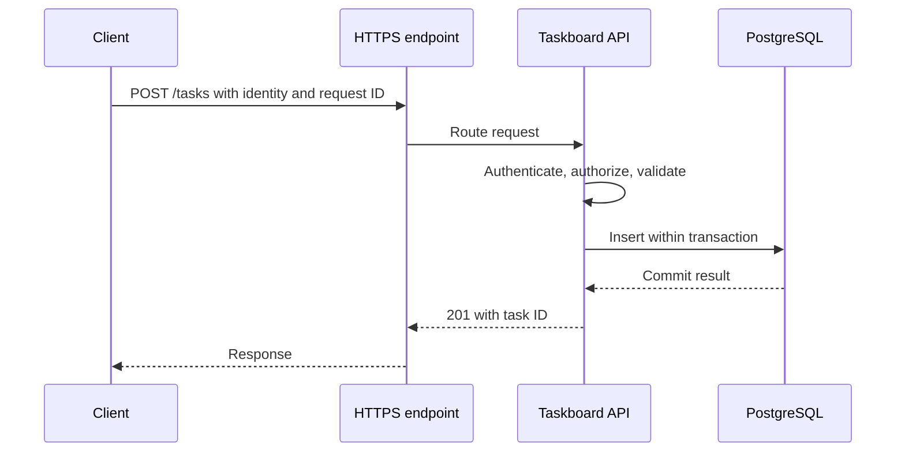

# Engineering handbook: reasoning about a service you can operate

This handbook accompanies the weekly labs. It assumes you can program, use Linux and work with Git, but are new to cloud operations. The examples follow **Taskboard**: a small HTTP application that creates, lists and updates tasks in PostgreSQL. Later it gains object storage for attachments and a worker for background processing. Those additions earn their place through a requirement or an experiment.

The examples are design exercises, not claims that an implementation has been deployed or tested. Numeric targets are proposed lab targets to validate and revise. The linked documentation was reviewed on 2026-10-20; use the documentation matching your pinned tool versions.

## 1. Follow one request before adding more infrastructure

When a user creates a task, the visible result depends on several independent systems. For the course's HTTPS-over-TCP path, DNS resolves the hostname, a connection reaches the endpoint, TLS establishes an authenticated encrypted session, and a proxy routes the HTTP request. Connections and DNS answers can be reused, so this is not necessarily repeated for every request.

Taskboard then authenticates the caller, checks whether they may modify that board, validates the input, obtains a database connection, performs a transaction and returns the result. A successful response should match the promised durability contract. Do not return “created” merely because work was placed in process memory.

Each boundary suggests a different test. DNS failure happens before application routing. A connection refusal differs from a timeout. A TLS hostname mismatch differs from expired authentication. HTTP 502 points toward a proxy/upstream interaction; it does not identify the root cause. HTTP 200 with incorrect data is still a failed user outcome.

Practice drawing this path from memory and attaching one observable signal to each step. Keep a request identifier in structured logs, propagate trace context when tracing is introduced, and record deployment version. These let you connect a user's complaint to a particular request and change.

## 2. Containers package processes; virtual machines package operating systems

A Linux container runs processes with isolated views and resource controls while sharing its host's kernel. A virtual machine has its own guest kernel. Docker Desktop can run Linux containers through a Linux VM on Windows; the Windows host and a Linux container are not interchangeable environments. [Docker's container explanation](https://docs.docker.com/get-started/docker-concepts/the-basics/what-is-a-container/).

An **image** is the packaged filesystem and configuration used to start a container. A **container** is an execution instance. Restarting a container does not rebuild the image; rebuilding an image does not automatically update a running instance. A tag is a movable name, whereas a digest identifies particular image content.

For Taskboard, keep application code in the image, environment-specific settings outside it, secrets in an appropriate secret-delivery mechanism and database data in explicitly managed persistent storage. A container's writable layer is the wrong place for data that must survive replacement.

Inside the API container, `localhost` means that container's own network namespace. It does not mean the PostgreSQL container or your laptop. Name resolution, exposed ports and network membership must agree.

Learn isolation by measuring it. Limit memory, observe a controlled exhaustion, inspect exit status and compare it with an application crash. Run as a non-root user where possible, grant only required capabilities, and understand that access to the Docker daemon can grant powerful control over its host. Containers reduce packaging friction; their presence alone proves neither safety nor portability.

## 3. Desired state requires clear ownership

“Three API instances should run” is a desired state. “Start another process now” is an action. Declarative tools express desired outcomes, but differ in how and when they act.

| Tool | Responsibility in this course | Evidence that matters |
|---|---|---|
| Terraform | Cloud networks, identity, compute, storage and managed services | Reviewed plan, correct account/region, protected state, clean second plan |
| Ansible | Packages, users, configuration and services on the VM stage | Correct inventory, reviewed changes, second run with no unintended changes |
| Kubernetes | Scheduling and reconciling workloads inside a cluster | Object status, events, healthy replicas, actual request behavior |
| Argo CD | Reconcile selected Kubernetes configuration from Git | Reviewed revision, intended diff, sync result and application checks |

Terraform normally acts when a plan/apply workflow runs. Ansible normally executes an ordered playbook when invoked. Kubernetes controllers continuously react to observed state. A Terraform plan is not a perpetual repair service; an Ansible playbook is not automatically idempotent because it uses YAML. [Terraform workflow](https://developer.hashicorp.com/terraform/intro), [Ansible execution and idempotency](https://docs.ansible.com/projects/ansible/latest/playbook_guide/playbooks_intro.html), [Kubernetes controller model](https://raw.githubusercontent.com/kubernetes/website/main/content/en/docs/concepts/architecture/controller.md).

Avoid two tools independently owning the same setting. If Terraform and Argo CD both change the same Deployment, each can undo the other's work. Similarly, an autoscaler needs a deliberately designed relationship with any configured replica count.

Taskboard's VM stage uses Terraform to create the VM and Ansible to configure it. Its Kubernetes stage moves application lifecycle management to Kubernetes. Keep this ownership boundary written down. When drift appears, identify its owner and reconcile the source of truth; a manual fix may otherwise disappear on the next run.

## 4. Test boundaries, not filenames

This course uses the following definitions. Teams sometimes name their test layers differently, so state what each suite actually includes.

| Layer | Taskboard example | What it can establish |
|---|---|---|
| Unit | A task-status transition rejects an invalid move | A small piece of logic satisfies its contract |
| Integration | Repository code inserts and queries a real PostgreSQL instance | Components agree on SQL, schema, transactions and serialization |
| System | An HTTP client creates, lists and updates a task through the deployed service | The assembled service fulfills a user-visible contract |

A mocked database cannot establish that PostgreSQL accepts your SQL or enforces your intended constraint. An in-memory substitute may differ in types, locking and transaction behavior. Use a disposable real database for the integration suite.

An integration fixture starts from a known database state, applies actual migrations, loads minimal data and exposes a connection to the test. A meaningful test inserts a task, reads it back and verifies ownership and fields. Another test attempts a duplicate constrained value and checks the application's expected response. Clean up even after failure, and give parallel jobs separate databases or schemas. [pytest fixture lifecycle and teardown](https://docs.pytest.org/en/stable/how-to/fixtures.html).

System tests should use the same image intended for deployment. Cover an authorized journey, denied access, malformed input and a dependency failure. Check stored results, not just HTTP codes.

Keep most logic tests fast, but do not force a cosmetic ratio between layers. Select tests by failure risk. When a defect escapes, identify the smallest boundary that could have detected it and add that regression test. Coverage percentages measure executed code, not the quality of assertions.

## 5. A GitLab pipeline is a privileged software system

Treat pipeline changes as executable code. A job can read its available credentials, modify its workspace and send network requests. Masking a variable in logs does not stop malicious job code from leaking it. Review pipeline configuration and included components with the same care as deployment code. Untrusted contributions must not run with production credentials or on a runner that exposes privileged host resources. [GitLab runner security](https://docs.gitlab.com/runner/security/).

For Taskboard, use a progression: validate source, run unit and integration tests, build an image, evaluate it, deploy that image to staging, run system checks, then authorize promotion. Retain the link between commit, pipeline, image digest and deployment. Building again for production can produce different content; promote the tested digest.

A **cache** accelerates repeated work, such as dependency downloads. Correctness must survive a cache miss. A **job artifact** carries a pipeline result, such as test reports or intermediate build output. A **registry** stores versioned release packages or container images. Restrict artifact access and retention because reports can contain sensitive data. [GitLab cache behavior](https://docs.gitlab.com/ci/caching/), [job artifacts and registries](https://docs.gitlab.com/ci/jobs/job_artifacts/).

OIDC-based cloud access lets a job present a signed identity token and obtain short-lived credentials. The important work is the trust policy: intended issuer and audience, exact project identity, appropriate protected branch or environment, and the smallest required permissions. OIDC with an overbroad trust policy is still dangerous. Test both an allowed pipeline and a denied one. [GitLab cloud identity federation](https://docs.gitlab.com/ci/cloud_services/).

Serialize changes to the same environment. A delayed older pipeline must not overwrite a newer approved deployment. Define rollback before release: previous image digest, compatible configuration, database constraints and the verification command. “Run the old image” is insufficient after a destructive schema change.

## 6. Reliability is a measurable agreement about user outcomes

An **SLI** is a defined measurement. An **SLO** is its target over a stated window. An **SLA** is an agreement with consequences; it is not another name for your dashboard target. An **error budget** expresses the failures allowed by the SLO. [Google SRE terminology](https://sre.google/sre-book/service-level-objectives/).

For a Taskboard lab, propose: “99.9% of valid, authorized task-read requests succeed over a rolling 28-day window, measured at the service's external endpoint.” Define which failures count, what constitutes success, how missing telemetry is handled and whether the measured traffic represents real users. Otherwise two engineers can compute different answers from the same incident.

With one million eligible requests, a 99.9% success target allows 1,000 unsuccessful requests. This is a request budget, not automatically a number of downtime minutes. A traffic spike during an outage can consume it rapidly. A lab with only a handful of synthetic probes cannot establish a production availability claim.

Add a separate latency objective, for example 99% of eligible successful reads below a justified threshold. Mark it provisional until workload measurements support it. Review the budget to choose work: repeated budget exhaustion suggests prioritizing failure reduction over another feature. Agree on that policy before an incident. [Implementing and using SLOs](https://sre.google/workbook/implementing-slos/).

**RTO** is the target recovery duration; **RPO** is the target tolerated data-loss interval. Suppose a lab fails at 11:07, service is restored at 11:24, and the latest recovered transaction is from 11:02. Measured recovery took 17 minutes and the recovered state is five minutes behind the failure. Compare those measurements with the stated objectives. A backup schedule alone proves neither. [AWS disaster-recovery planning](https://docs.aws.amazon.com/wellarchitected/latest/reliability-pillar/plan-for-disaster-recovery-dr.html).

## 7. Data changes deserve their own release design

Application instances are replaceable only if their durable state remains understandable. A database migration can break old code while a rolling deployment still runs both versions.

Suppose Taskboard renames `title` to `summary`. An immediate destructive rename couples the database change to every running instance. A safer learning exercise is:

1. Add the new nullable field without removing the old field.
2. Deploy compatible code that writes both and can read the old value when the new value is absent.
3. Backfill existing rows in bounded, concurrency-safe batches.
4. Check completeness and switch reads once every instance understands the new schema.
5. Remove compatibility behavior and the old field only after the agreed rollback window closes.

This is a design pattern to adapt, not a universal migration script. Consider transaction locks, table size, concurrent writes, timeouts and failed batches. A migration that is harmless on ten rows can block users on millions. Inspect the actual PostgreSQL operation and its locking behavior. [PostgreSQL ALTER TABLE](https://www.postgresql.org/docs/current/sql-altertable.html).

Replication and backups address different failures. Replication can make another copy available quickly, but an accidental deletion may also replicate. A recoverable historical backup helps with that deletion, provided the required files and keys survive and restoration works.

Test recovery into a separate environment. Verify schema version, important row relationships, attachment references and application behavior before redirecting users. Record recovery duration and lost data. PostgreSQL documents logical dumps, filesystem backups and continuous archiving as distinct approaches; choose deliberately instead of assuming any copied directory is recoverable. [PostgreSQL backup and restore](https://www.postgresql.org/docs/current/backup.html).

## 8. Security starts with what an identity can do

A threat model is a concrete account of assets, entry points, trust boundaries and plausible misuse. For Taskboard, assets include task data, attachments, signing material, cloud permissions and backups. Entry points include HTTP routes, uploaded files, Git contributions and administrative access.

Ask what happens when each boundary is crossed incorrectly. Can user A read user B's board by changing an identifier? Can an uploaded filename change a filesystem path? Can a pull request obtain deployment credentials? Can a compromised API delete backups? These questions turn “secure” into testable requirements.

Assign identities by responsibility. The application needs access to its own data and selected objects. The deployment job needs to update its workload. The backup role needs the permissions required by its specific backup method. They should not share an administrator identity. Prefer temporary workload credentials where supported, and test denied operations as well as successful ones. [AWS IAM security practices](https://docs.aws.amazon.com/IAM/latest/UserGuide/best-practices.html).

Encryption, authorization and isolation solve different problems. TLS protects a connection; it does not decide whether the caller may read a board. Encrypted backups still need protected decryption keys. Network restrictions reduce reachability, but do not replace application authorization.

Treat images, dependencies and pipeline components as part of your trusted supply chain. Pin and inventory them, review updates, scan for known problems and record exceptions with owners and deadlines. A clean scan cannot prove the absence of vulnerabilities. The engineering evidence is a maintained process plus tested controls.

## 9. Scale the bottleneck you measured

Scaling means meeting a defined workload within latency, correctness and cost constraints. Begin by stating the mix: reads versus writes, payload sizes, dataset size, concurrent users and burst behavior. Ten concurrent users reading tiny tables is not equivalent to ten users uploading large attachments.

Record throughput, errors, resource saturation and a latency distribution. The p95 is a value at or below which about 95% of observed requests fall; it is not the average of the slowest 5%. A fast median can coexist with an unacceptable tail. Do not average instance percentiles to obtain a fleet percentile; use aggregatable observations such as suitable histograms.

More API replicas can make a database bottleneck worse. If each replica opens twenty connections, increasing from two to ten replicas changes the possible demand from forty to two hundred. Investigate slow queries, indexes, connection pools and lock contention before scaling blindly.

A queue can absorb a burst and move work out of a request, but it creates backlog and retry semantics. Measure the age of the oldest unfinished item as well as queue length. Decide how poison messages are isolated and how users learn that work failed.

For an attachment-processing worker, assume a message may be delivered again. Use a durable operation key and atomic state transition so a retry cannot create duplicate business effects. External side effects require their own deduplication or reconciliation strategy. Bound retries, add backoff and jitter, and distinguish transient faults from invalid input. [AWS guidance on timeout and retry behavior](https://aws.amazon.com/builders-library/timeouts-retries-and-backoff-with-jitter/).

## 10. Diagnose with competing hypotheses

Start with impact: which action fails, for whom, since when, and how often? Establish whether the issue affects every instance, one zone, one release or one route. Record recent changes without assuming the newest change is automatically responsible.

For “Taskboard became slow,” write competing explanations:

| Hypothesis | Useful evidence | Small discriminating check |
|---|---|---|
| CPU saturation | CPU and throttling rise with latency | Compare workload and affected instances |
| Database contention | Pool wait or transaction duration rises | Inspect query/lock behavior |
| Routing failure | Proxy errors increase while app traffic falls | Compare endpoint and direct-service checks |
| Slow dependency | Specific trace span dominates | Exercise that dependency separately |

Choose the check that separates explanations with the least disruption. Logs show particular events, metrics reveal aggregate changes, and traces relate work along a request. None alone contains the whole system.

Mitigate user impact before chasing a perfect explanation when necessary. A rollback may be appropriate if compatibility is established. Capture evidence before restarting a process where feasible; otherwise you may erase the information needed to prevent recurrence.

After recovery, distinguish the trigger from contributing conditions. “The engineer deployed a bug” explains little. Missing validation, unsafe defaults, excessive permissions or an ineffective rollback path are actionable findings. A useful postmortem states impact, timeline, evidence, contributing factors and a small set of owned improvements. [Google SRE troubleshooting methodology](https://sre.google/sre-book/effective-troubleshooting/).

## 11. Know what your evidence actually proves

For every milestone, retain a short engineering record: the requirement, design, assumptions, tested failure, result and remaining limit. A screenshot proves a screen existed. A reproducible test demonstrates a behavior under its stated conditions. A recovery drill establishes a measured result for that dataset and procedure; it does not guarantee every future incident.

When reviewing Taskboard, explain one rejected design, one failure you caused safely, how you detected it, and what changed afterward. If you can operate the system only while following the tutorial line by line, repeat the lab from a clean environment with only your runbook.

Before adding a platform, ask which operational problem it solves, which new failure modes it introduces, who owns it and how it is removed. The strongest portfolio shows a coherent service, clear tradeoffs and evidence of recovery. Your growing expertise should be visible in the quality of those decisions.
